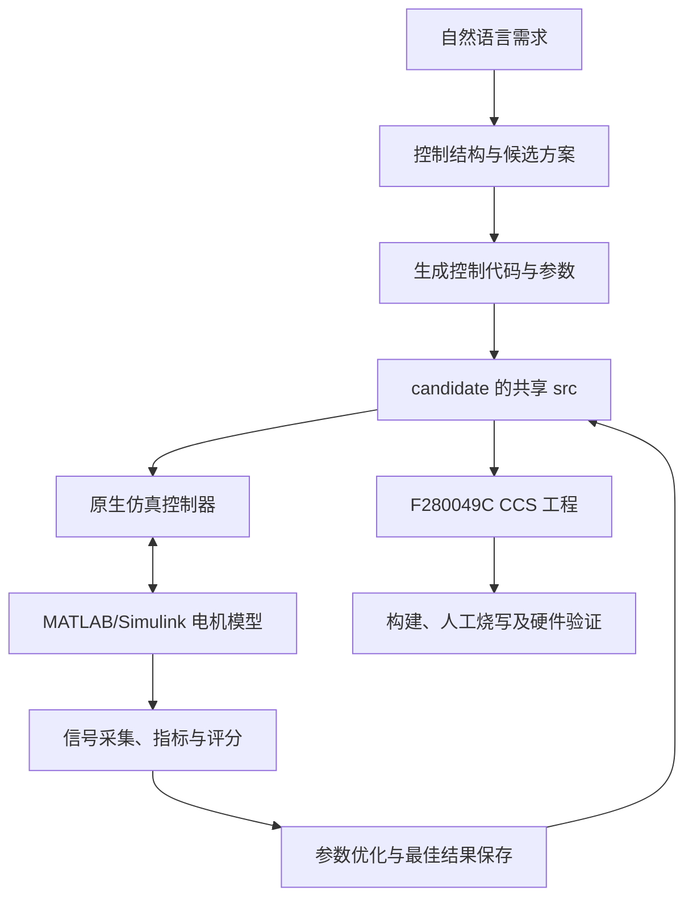

# MotorAI 项目说明

更新日期：2026-10-11。项目根目录：`D:/Code/MotorAI/MotorAIv2`。

MotorAI 是配合 GMP 控制平台使用的自然语言控制方案生成和参数优化工具。用户描述控制需求，系统组织控制结构、生成候选方案，并通过原生控制器与 MATLAB/Simulink 模型联合仿真评价参数。当前候选方案同时输出仿真工程和 F280049C CCS 工程。

当前修改交接、验证范围和待办见 [HANDOFF.md](D:/Code/MotorAI/MotorAIv2/HANDOFF.md)。

## 1. 基本原理

LLM 负责将自然语言转换为控制结构、组件选择和优化建议；Python 将结构化结果与既有 C/C++ 模板及 GMP 控制组件组合。编译和仿真负责验证程序，评价模块根据采集信号计算指标和得分。

控制代码不是凭对话直接任意生成后就用于硬件：生成器基于已有模板及组件接口构造程序；调优主要修改允许调整的参数，依赖真实构建和仿真反馈。新控制算法或新板型仍需要对应的模板、参数规则及接口适配。



一次内层迭代是“写参数 → 构建 → 仿真 → 评价 → 决定下一组参数”。一轮外层竞争则包含多个 candidate 的生成、调优和比较；必要时根据本轮结果生成下一轮方案。两类迭代的记录分别保存在 candidate 和工程 `rounds/` 中。

停止条件除了整体得分，还可包括最低单项得分、评价错误数量和迭代/轮次上限。看到整体分数较高而仍继续迭代时，应查看具体停止条件及最弱指标。

## 2. 代码结构与职责

| 目录/文件 | 职责 |
| --- | --- |
| [Generate](D:/Code/MotorAI/MotorAIv2/Generate) | 控制结构与组件导出、代码合并、控制模板。 |
| [Generate/ui](D:/Code/MotorAI/MotorAIv2/Generate/ui) | PyQt5 界面、对话、控制程序/需求面板、网络设置、历史记录和工作流。 |
| [Competition](D:/Code/MotorAI/MotorAIv2/Competition) | 多候选工作区、参数初始化、轮次调度、证据与反馈、F280049C 工程生成。 |
| [Optimize/agent_optimize](D:/Code/MotorAI/MotorAIv2/Optimize/agent_optimize) | 优化 Agent、工具调用、参数编辑、构建/仿真调度、评价和检查点。 |
| [Optimize/agent_silhelper](D:/Code/MotorAI/MotorAIv2/Optimize/agent_silhelper) | MATLAB/Simulink SIL 模型准备、运行、通信与数据提取。 |
| [silworker](D:/Code/MotorAI/MotorAIv2/silworker) | 可独立部署的远程仿真 HTTP worker，含 helper 副本。 |
| [HardwareConfig](D:/Code/MotorAI/MotorAIv2/HardwareConfig) | 硬件配置相关工具；当前 candidate 的 F280049C 导出集成在 Competition 中。 |
| [motorai_config.py](D:/Code/MotorAI/MotorAIv2/motorai_config.py) | 统一读取本机配置和项目路径。 |
| `motorai_settings.json` | 本机 LLM、路径等设置，默认不纳入 Git。 |
| [tests](D:/Code/MotorAI/MotorAIv2/tests)、[docs](D:/Code/MotorAI/MotorAIv2/docs) | 回归测试、迁移及问题处理记录。 |
| `Output/` | 用户工程、候选方案、日志、调优结果和轮次记录，默认不纳入 Git。 |

生成新方案时主要参考 [控制组件导出器](D:/Code/MotorAI/MotorAIv2/Generate/controller_loop_id_exporter.py) 和 [代码合并器](D:/Code/MotorAI/MotorAIv2/Generate/merge_loop_ids_into_ctl_main.py)；执行和恢复主要参考 [competition_runner.py](D:/Code/MotorAI/MotorAIv2/Competition/competition_runner.py) 与 [优化入口](D:/Code/MotorAI/MotorAIv2/Optimize/agent_optimize/agent_core/app.py)。

## 3. 运行环境

| 功能 | 所需环境 |
| --- | --- |
| 图形界面与代码生成 | Python、[UI requirements](D:/Code/MotorAI/MotorAIv2/Generate/ui/requirements.txt) 中的 PyQt5/matplotlib/openai；可用的模型接口和 API key。 |
| GMP 控制器编译 | 新版 GMP 根目录、Visual Studio C++ 工具链/MSBuild、仿真工程所需第三方库。 |
| 本地 SIL 调优 | MATLAB、Simulink、模型需要的工具箱及可用 MEX C++ 编译器；当前电机模型用到 Simscape Electrical。共享 MATLAB Engine 模式另需安装匹配的 Python Engine。 |
| 远程 SIL | 远程机器安装同等模型/编译依赖，配置并启动当前版本 silworker；主端能访问 worker 和控制数据端口。 |
| F280049C 构建/烧写 | CCS、C2000 编译器、C2000Ware、GMP 产品/路径配置；烧写还需要开发板及调试连接。 |

本机已有验证包含 MATLAB R2025b、MinGW MEX、CCS 12.8.1、SysConfig CLI 1.26.2，以及 F280049C 模板使用的 C2000 CGT 22.6.2.LTS。它们是验证环境记录，不是对其他版本兼容性的保证。UI requirements 只覆盖列出的 Python 包，不负责安装原生编译器、MATLAB、CCS 或 GMP 第三方库。

## 4. 配置与启动

以下 PowerShell 命令在项目根目录执行。已有 `.venv` 时可以直接使用；新环境可先创建虚拟环境并安装 UI 依赖：

```powershell
Set-Location -LiteralPath 'D:/Code/MotorAI/MotorAIv2'
python -m venv .venv
& .\.venv\Scripts\python.exe -m pip install -r .\Generate\ui\requirements.txt
```

在界面设置或根目录 `motorai_settings.json` 中配置模型地址、模型名称、API key 和 GMP 路径。下面是最小配置示意；应将占位值换成实际配置，已有配置只修改需要的字段：

```json
{
  "llm": {
    "base_url": "https://your-provider.example/v1",
    "model": "your-model-name",
    "api_key": "your-api-key"
  },
  "paths": {
    "gmp_root": "D:/Code/gmp_pro",
    "generate_root": "Generate",
    "optimize_root": "Optimize",
    "output_root": "Output"
  }
}
```

相对路径按 MotorAI 根目录解析。根配置支持 `MOTORAI_SETTINGS_PATH` 覆盖默认文件；对话和生成入口还支持从 `SILICONFLOW_API_KEY` / `OPENAI_API_KEY` 读取 key。不同独立入口的配置读取细节需以其代码为准。

[motorai_settings.example.json](D:/Code/MotorAI/MotorAIv2/motorai_settings.example.json) 可作为字段参考，但其中的示例输出路径应改为本机计划使用的工作区，例如 `Output`，不要原样采用其他机器的 GMP suite 路径。不要将实际 key 写入项目说明或提交记录。

启动 UI：

```powershell
& .\.venv\Scripts\python.exe .\Generate\ui\main.py
```

更换 GMP 后要确认新根目录通过校验，构建脚本及候选配置使用同一个平台。CCS 工程里的 GMP 链接和产品变量也需指向实际安装；已有硬件工程会保留人工配置，不会每次初始化都强制改写。

## 5. 日常工作流程

1. 新建/打开工程，在对话框描述控制目标，确认控制结构与方案；生成多个 candidate 时，可采用不同控制方法或初始参数策略。
2. 配置负载曲线、目标信号和评价指标，检查单位、目标值、约束及停止条件；确认本地/远程仿真模型和网络设置。
3. 启动调优。程序准备 SIL 契约、构建控制器、等待控制器就绪、运行模型、采集信号并评分，然后更新允许优化的参数。
4. 根据实时阶段、指标、最佳参数和轮次结果查看进展。失败时打开对应日志，修复失败阶段后再恢复。
5. 选定结果后，导入同一 candidate 的 F280049C CCS 工程构建，检查实际板级配置后再烧写验证。

算法模板、板级物理参数与调优参数有不同用途。优化器按允许参数及范围调整控制参数；模型的物理连线、采样缩放、PWM/编码器方向和硬件资源不能仅靠优化评分确定。

## 6. 输出工程结构与参数共享

默认工作区位于 `D:/Code/MotorAI/MotorAIv2/Output`，典型结构如下（部分文件在运行对应阶段后才出现）：

```text
Output/<工程名>/
  <工程名>.json
  common/
  candidates/
    candidate_01/
      candidate.json
      src/
        ctl_main.c / ctl_main.h
        user_main.c / user_main.h
        paras.generated.h
      project/
        simulate/
        f280049c/
      log/
        generate/
        optimize/
          tuning_result.json
          run_optimize_stdout.txt
          run_optimize_stderr.txt
          build/
          simulation/
    candidate_02/
      ...
  rounds/
    round_NN/
      run_state.json
    iteration_summary.json
  log/ui/
    competition_runner_stdout.txt
    competition_runner_stderr.txt
    paused_task.json
```

每个 candidate 的控制代码和 `paras.generated.h` 是该方案的共享输入。`simulate` 与 `f280049c` 分别负责主机仿真和 C2000 平台构建；调优结束不再单独复制参数到另一套硬件目录。

复制/归档工程时保留 candidate 的 `src` 和两个 `project` 子目录。GMP 和 C2000Ware 保持外部依赖，不需要复制整套平台，但目标机器必须能解析相应路径和产品配置。

## 7. 停止、继续与历史工程

任务运行时，对话框右侧发送按钮变为停止按钮；后台状态显示与其他等待环节相同的旋转动画。点击停止后先保存状态并清理任务，清理完成后可以继续输入指令。

输入“继续运行”“继续调优”等指令可恢复暂停任务。已完成的迭代和最佳参数可复用；被中断的仿真重新运行。它不保存 MATLAB 进程内存或仿真时间点，不能按瞬时状态继续积分。需求或运行身份发生变化时会重新检查评价有效性。

远程停止需要更新后的 worker 支持取消接口。界面仍显示停止清理中时，查看 worker 和 `remote_active.json`，确认实际任务已经结束。更新代码后重启 MotorAI 和 worker 才能载入新实现。

历史工程支持右键“查看详情”“打开工程”“从历史移除”“删除工程…”。“从历史移除”保留文件；“删除工程”确认后送入回收站。运行中的工程禁止删除；删除失败保留历史记录。

## 8. F280049C 与 SysConfig 的使用

在 CCS 导入所选 candidate 的 `project/f280049c`，保留其与 `src/` 的相对目录关系。若复制进 CCS workspace，应同时保留所需的 candidate 结构，避免只复制硬件工程导致 linked resources 失效。

模板提供 Debug/Release 配置及启动、链接、板级支持文件。GMP 源链接指向所选 GMP 根目录，C2000Ware 使用 CCS 产品变量。CCS 产品版本标签应与本机注册信息一致，不能仅根据 GMP 源码版本猜测。

新生成的工程自动运行 SysConfig，使用配置目录下的 `syscfg` 输出，并排除工程根目录复制的旧生成代码。`.cproject` 保留 CCS 所需的 fileVersion 处理指令，SysConfig 输入明确指向根目录 `280049C_LaunchPad.syscfg`。

已有 `Output/test4/candidates/candidate_02` 是兼容例外：已修复 SysConfig 编辑器参数，但继续编译冻结的根目录 `syscfg/` 文件。其人工脚本与接口的资源命名不同，直接重新生成会出现 IRIS 宏缺失；统一映射后才能改为自动生成模式。详见 [交接文档](D:/Code/MotorAI/MotorAIv2/HANDOFF.md)。

当前留存验证证明当前工程副本和新生成工程的 CCS 导入及 Debug/Release 构建通过；没有实际开发板烧写、电机运行或 CCS 图形编辑器打开的验收记录。仿真最佳参数应经实际板级检查后用于硬件测试。

## 9. 日志与排障入口

| 要确认的事情 | 文件/位置（相对具体工程或 candidate） |
| --- | --- |
| UI 启动的 runner 当前阶段 | 工程 `log/ui/competition_runner_stdout.txt` 与 stderr 文件 |
| 单个 candidate 优化失败原因 | candidate `log/optimize/run_optimize_stderr.txt`；同目录 stdout |
| 编译、控制器运行、模型和数据问题 | candidate `log/optimize/build/`、`simulation/` 下的阶段日志和产物 |
| 已完成迭代、当前/最佳参数 | candidate `log/optimize/tuning_result.json` |
| 轮次摘要、恢复状态 | 工程 `rounds/iteration_summary.json`、`rounds/round_NN/run_state.json` |
| 暂停和远程清理状态 | 工程 `log/ui/paused_task.json`、candidate `log/optimize/simulation/remote_active.json` |

遇到“后台运行中”先看最后日志阶段；模型调用、编译和仿真都可能耗时。返回码 1 只是外层失败标记，具体原因在 stderr 或阶段日志中。通信错误先核对所选 GMP、模型路径/Connection ID、协议和两个数据端口。

## 10. 开发与验证

修改生成行为时同时关注模板、合并器和工作区初始化；手工修复 `Output/` 里的一个工程不会改变后续生成结果。停止/恢复相关修改应检查本地进程归属、远程取消确认和检查点需求匹配，避免重复推进轮次。

回归测试入口：

```powershell
$env:QT_QPA_PLATFORM = 'offscreen'
& .\.venv\Scripts\python.exe -m unittest discover -s tests -p 'test_*.py'
```

当前共定义 50 项测试，覆盖 GMP SIL、进度/轮次、停止/恢复、文件锁、历史工程和 F280049C 生成。真实 LLM 调用、MATLAB 中断恢复、跨机器部署及硬件运行仍需独立验收。历史已验证结果和待办清单见 [HANDOFF.md](D:/Code/MotorAI/MotorAIv2/HANDOFF.md)，细节见 [迁移实施记录](D:/Code/MotorAI/MotorAIv2/docs/gmp_pro_migration_implementation_20261009.md) 与 [停止恢复记录](D:/Code/MotorAI/MotorAIv2/docs/task_pause_resume_implementation_20261010.md)。

工作区和配置默认不在 Git 中。移交给另一台机器时，除了代码，还需按需归档用户工程/证据并重新配置依赖和路径；本文链接使用当前机器绝对路径，搬迁后需要更新。
